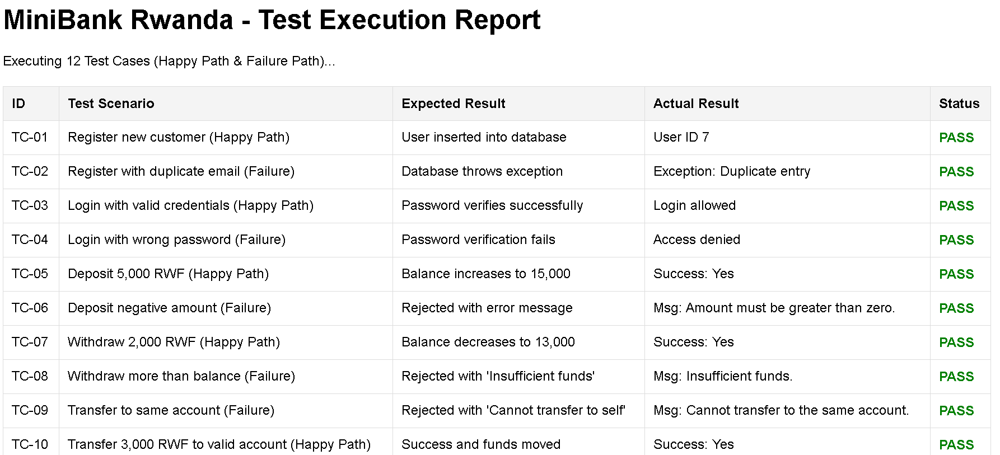
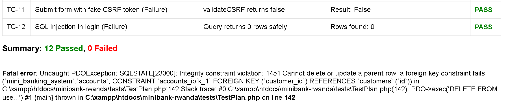

# MiniBank Rwanda
** Banking Simulation System**

A full-stack, secure, and responsive online banking management system built with Core PHP (OOP), MySQL, Vanilla JavaScript, and pure CSS. 

## 🚀 Features
- **Authentication:** Secure registration, login, and logout with Bcrypt password hashing and CSRF protection.
- **Customer Dashboard:** Real-time balance tracking, multi-account management, and quick actions.
- **Transactions:** Secure deposits, withdrawals, and double-entry atomic money transfers.
- **Statements:** Generate and print professional PDF bank statements.
- **Admin Panel:** Complete control over customers, accounts, transactions, system settings (logo/slogan), and contact messages.
- **Contact Form:** Public contact form with messages saved directly to the admin database.

## 🛠️ Setup Instructions (XAMPP on Windows)

### 1. Server Setup
1. Open the **XAMPP Control Panel**.
2. Start **Apache** and **MySQL**.
3. Copy the entire `minibank-rwanda` folder into your XAMPP web root directory:
   `C:\xampp\htdocs\`

### 2. Database Setup
1. Open your browser and go to `http://localhost/phpmyadmin/`.
2. Create a new database named exactly: `mini_banking_system`.
3. Click the **Import** tab.
4. Choose the file `database/schema.sql` and click **Go**.
5. (Optional) Import `database/seed.sql` to add test customers.

### 3. Environment Configuration
1. Open the project folder and locate the `.env` file (if it doesn't exist, rename `.env.example` to `.env`).
2. Open `.env` in a text editor (like VS Code or Notepad) and update your database credentials:
   ```env
   APP_ENV=development
   APP_URL=http://localhost/minibank-rwanda/public/
   
   DB_HOST=localhost
   DB_NAME=mini_banking_system
   DB_USER=root
   DB_PASS=""
  ## 🔐 Default Credentials##
  Administrator Account
.URL: http://localhost/minibank-rwanda/public/login.php

.Email: niragire_224007101@stud.ur.ac.rw

.Password: admin123
Test Customer Accounts:
1.Customer1:
2.customer2:


=======
# BIT-Y3-G2--224007101---MINIBANK-
Online Banking Mini System which help customers to register,deposit,withdraw,view balances,transfer and see history

